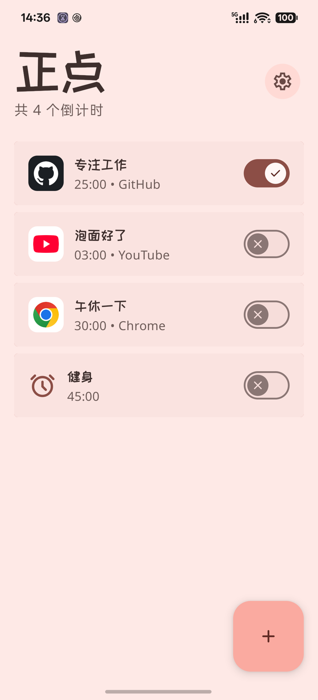
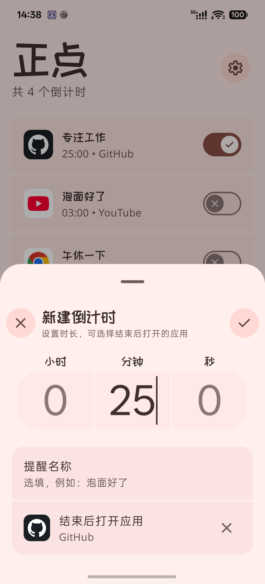
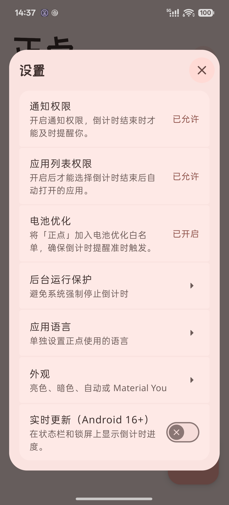
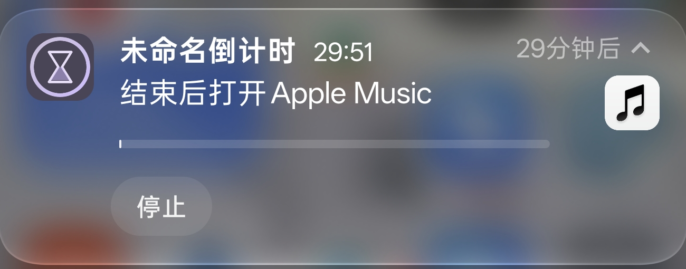
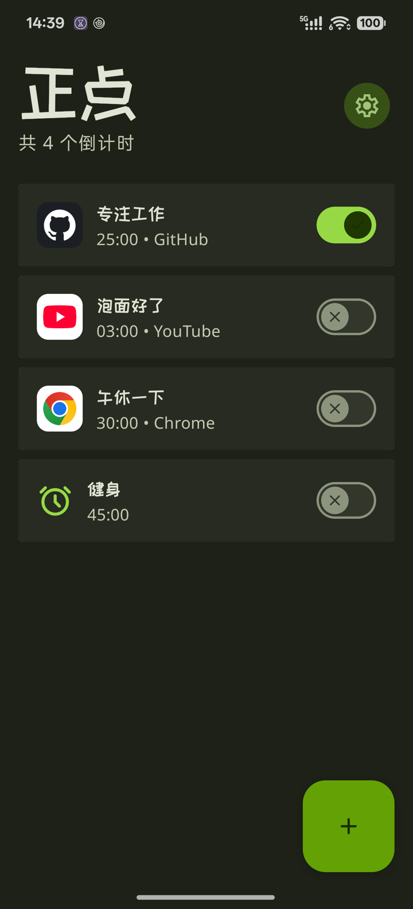

# 正点 · TimeUp


> 时间到了，不只是提醒你，还带你回到下一步。


正点（TimeUp）是一个本地优先的 Android 倒计时应用。

设置好时、分、秒，再选一个“结束后打开”的应用。倒计时期间，通知栏会实时显示剩余时间和进度；结束时点一下通知，就会重新开始这个倒计时，并直接打开你选好的应用。适合泡面、午休、专注、健身等“到点就该做下一件事”的场景。

## 截图

|                                    首页                                     |                                       新建倒计时                                        |
|:---------------------------------------------------------------------------:|:---------------------------------------------------------------------------------------:|
| [](docs/screenshots/home.png) | [](docs/screenshots/add-countdown.png) |
|                         倒计时、目标应用与一键启停                          |                              时 / 分 / 秒、名称与目标应用                               |

|                                    选择应用                                     |                                  设置                                   |
|:-------------------------------------------------------------------------------:|:-----------------------------------------------------------------------:|
| [](docs/screenshots/select-app.jpg) | [](docs/screenshots/settings.png) |
|                                按名称或包名搜索                                 |                       权限、后台保护、语言与外观                        |

## 功能

### 倒计时，一眼就能开始

- 小时 / 分钟 / 秒三段输入，最长支持 23:59:59。
- 名称为可选项，不填时显示“未命名倒计时”。
- 每个倒计时都有独立开关，支持多个倒计时同时运行。
- 首页直接显示时长和目标应用，运行状态一目了然。

### 结束之后，点一下就到下一步

倒计时进行中，通知栏会显示剩余时间、进度条和“停止”操作；即使离开应用，计时也不会中断。

结束时弹出高优先级通知。点击通知会重新开始这个倒计时，并打开预设的应用；没有选择目标应用或目标应用已被卸载时，会回到正点。



*进行中的通知：剩余时间、目标应用、进度与停止操作。*

### 列表管理

- 左滑删除，底部出现 3 秒撤销条；撤销前不会真正删除。
- 运行中的倒计时不能编辑，避免计时状态被误改。
- 重新打开应用时，会自动恢复仍在运行的倒计时。
- 通知栏的“停止”会结束计时并把倒计时恢复为关闭状态。

### 选择结束后的应用

- 按应用名称或包名搜索，快速定位目标应用。
- 可切换“显示系统应用”，也可以手动刷新列表。
- 首次使用会引导授予应用列表权限；不同 Android 版本和厂商的权限入口可能不同。

### 按你的方式显示

|                                      深色主题                                       | 说明                                                                                                             |
|:-----------------------------------------------------------------------------------:|------------------------------------------------------------------------------------------------------------------|
| [](docs/screenshots/dark-theme.png) | 亮色、暗色、自动和 Material You 动态取色。Material 3 Expressive 组件、边到边布局，横屏刘海区域也做了内边距适配。 |

- 应用语言可单独设为跟随系统、English 或简体中文。
- 主题切换立即生效，不需要重启应用。

### 后台更稳

- 使用前台服务 + 持续通知承载倒计时，退到后台也能继续计时。
- 设置页集中提供通知权限、应用列表权限、电池优化白名单和后台保护指引。
- Android 16+ 支持“实时更新”开关，把倒计时进度显示在状态栏和锁屏。
- 所有数据都留在本地，应用不申请网络权限。

## 技术栈

| 类别       | 技术                                                                   |
|------------|------------------------------------------------------------------------|
| 语言与构建 | Kotlin 2.4.21 · JDK 17 · AGP 9.5.1 · Gradle 9.9                        |
| UI         | Jetpack Compose（BOM 2026.09.00）· Material 3 1.5.0-rc01（Expressive） |
| 架构       | MVVM + 单向数据流 · Hilt 2.60.1 · Coroutines / Flow                    |
| 本地数据   | Room 2.8.5（KSP）· DataStore Preferences 1.1.7                         |
| 系统能力   | 前台服务 · 持续通知 · 通知操作 · 应用列表 · 电池优化                   |
| 测试       | JUnit4 · Compose UI Test                                               |
| 平台       | minSdk 27（Android 8.1）· compileSdk / targetSdk 37                    |

## 项目结构

```text
app/src/main/kotlin/io/wiger/timeup/
├── MainActivity.kt              # 入口，应用主题与语言
├── TimeUpApplication.kt         # Hilt、DataStore、通知渠道初始化
├── core/                        # 语言、权限、系统设置跳转
├── data/
│   ├── local/                   # Room 数据库、DAO、实体
│   ├── repository/              # TimeUp / AppInfo 仓库
│   ├── datasource/              # 已安装应用列表
│   └── model/                   # 领域模型
├── di/                          # Hilt 模块
├── notification/
│   ├── AlertService.kt          # 前台倒计时服务
│   ├── RetryLaunchActivity.kt   # 结束通知 → 重开 + 打开目标应用
│   ├── NotificationUtil.kt      # 通知渠道与权限
│   └── CountdownTiming.kt       # 纯计时计算（有单元测试）
└── ui/
    ├── home/                    # 首页、列表、删除撤销
    ├── addalert/                # 新建 / 编辑倒计时
    ├── selectapp/               # 应用选择器
    ├── settings/                # 设置
    ├── component/               # 通用组件
    └── theme/                   # Material 3 Expressive 主题
```

## 数据流

```text
Compose UI
   │  用户操作
   ▼
ViewModel（Home / AddAlert / SelectApp）
   │
   ├── Repository ──► Room（倒计时、应用缓存）
   │                 DataStore（主题、实时更新偏好）
   │
   └── Intent ──► AlertService（前台服务）
                    │
                    ├── 进行中通知：剩余时间 + 进度 + 停止
                    └── 结束通知 ──► RetryLaunchActivity
                                          ├── 重新开始倒计时
                                          └── 打开目标应用（失败则回到正点）
```

## 构建与运行

**环境要求**

- JDK 17 或更高版本
- Android SDK 37（compileSdk / targetSdk 37）
- 支持 AGP 9.5.1 的 Android Studio
- Android 8.1（API 27）及以上的设备或模拟器

```bash
git clone https://github.com/WigerCheng/TimeUp.git
cd TimeUp

# 构建 debug APK
./gradlew :app:assembleDebug

# 安装到已连接的设备
./gradlew :app:installDebug
```

`local.properties` 中的 `sdk.dir` 由 Android Studio 自动生成，不需要提交到版本库。Release
构建开启了代码压缩与资源收缩。

### 发布

- 标签触发发布：`git tag v1.0.1 && git push origin v1.0.1`。
- 手动发布：Actions → Android Release → Run workflow。`tag` 留空时使用 `v<versionName>`
  （当前为 `v1.0.0`），也可以显式填写标签；标签不存在时会在本次运行的提交上自动创建。
- 如果同名标签已存在于其他提交，工作流会在构建前失败，请先更新 `versionCode` / `versionName`
  或填写新的标签。
- 手动运行请选择包含此工作流文件的分支（通常是 `main`）。

**测试**

```bash
# 计时边界等 JVM 单元测试
./gradlew :app:testDebugUnitTest

# 需要连接设备：Compose UI 与内边距/滚动测试
./gradlew :app:connectedDebugAndroidTest
```

## 主要权限

| 权限                                                              | 用途                                            |
|-------------------------------------------------------------------|-------------------------------------------------|
| `POST_NOTIFICATIONS`                                              | Android 13+ 显示倒计时进行中与结束通知          |
| `POST_PROMOTED_NOTIFICATIONS`                                     | Android 16+ 的“实时更新”，在状态栏/锁屏显示进度 |
| `FOREGROUND_SERVICE`、`FOREGROUND_SERVICE_SYSTEM_EXEMPTED`        | 倒计时期间保持前台服务运行                      |
| `QUERY_ALL_PACKAGES`、`com.android.permission.GET_INSTALLED_APPS` | 读取已安装应用，供“结束后打开应用”选择          |
| `REQUEST_IGNORE_BATTERY_OPTIMIZATIONS`                            | 引导用户把正点加入电池优化白名单                |

## 数据与隐私

- 倒计时保存在本地 Room 数据库，主题等偏好保存在 DataStore。
- 应用列表仅用于填充选择器，并缓存在本地。
- 不申请 `INTERNET` 权限，没有账号、云同步或统计 SDK。
- 数据保存在应用私有目录，应用本身不会上传到服务器。

## 已知限制

- 部分厂商的电池管理会强制停止后台服务，建议在设置页完成电池优化和后台保护配置。
- 从通知打开目标应用会受到后台启动 Activity 限制的影响；应用已通过无界面中转 Activity 兼容，但个别 ROM
  仍可能拦截。
- “实时更新”仅在 Android 16+ 且系统允许 promoted ongoing notifications 时可用。
- 应用列表权限的可用性随 Android 版本和厂商定制而不同。

## English

**TimeUp (正点)** is a local-first countdown app for Android 8.1+. Pick a duration and an optional
app; when the timer ends, tap the notification to restart the countdown and open the selected app.
It supports multiple countdowns, live progress notifications, swipe-to-delete with undo, Material
You theming, and a Chinese/English UI.

Built with Kotlin, Jetpack Compose, Material 3 Expressive, Room, Hilt, and a foreground service. No
network permission; all data stays on the device.

---

用 Kotlin 与 Jetpack Compose 构建 · 所有数据留在本地
